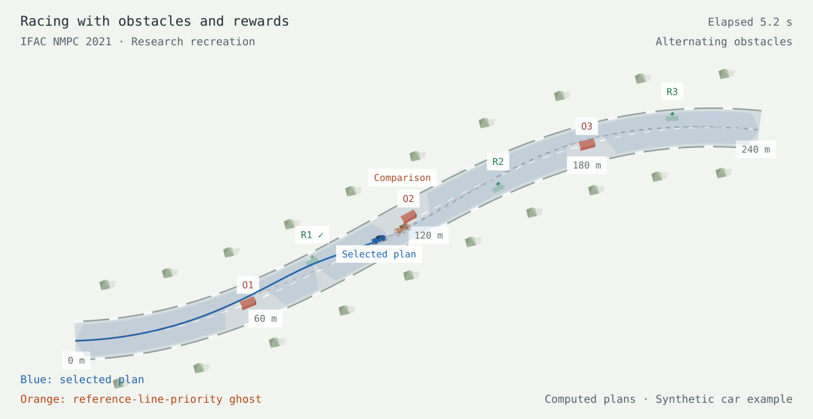
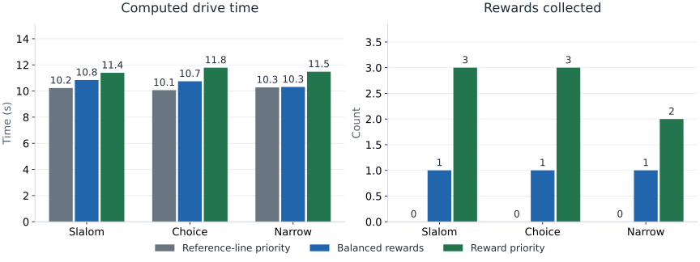

# Racing & Rewards

**Mixed-integer optimization-based planning for autonomous racing with obstacles and rewards**

Rudolf Reiter · Martin Kirchengast · Daniel Watzenig · Moritz Diehl

IFAC Conference on Nonlinear Model Predictive Control · NMPC 2021. [IFAC PapersOnLine 54(6), 99–106](https://doi.org/10.1016/j.ifacol.2021.08.530).

> **Recreated implementation — not the original repository.** This independent, simplified implementation demonstrates the paper’s core ideas. All reported numbers are new synthetic results, not recovered original experiments.

[Paper](https://publications.syscop.de/Reiter2021a.pdf) · [Interactive page](https://RudolfReiter.github.io/racing-rewards/) · [Reproduction details](REPRODUCTION.md) · [Evaluation data](docs/data/summary.json)



How should a race car choose between the racing line, an obstacle-free detour, and an optional reward? Explore the paper’s two-stage planning idea: discrete decisions first, continuous motion second.

[Download the animated scene preview](docs/assets/driving-preview.gif) (opens separately).

## Run locally

```bash
git clone https://github.com/RudolfReiter/racing-rewards.git
cd racing-rewards
python -m venv .venv
source .venv/bin/activate
python -m pip install -r requirements-reproduce.txt -e .
python -m racing_rewards.experiment
python scripts/plot_results.py
python -m pytest -q
python -m http.server 8000 --directory docs
```

Use Python 3.9–3.12 for the pinned reproduction environment.

Open **http://localhost:8000**. The website also works using the committed data without installing the Python package. The Python experiment is the optimizer; browser controls select already computed runs.

The scene starts paused. Play or scrub time, compare the synchronized orange ghost, and switch between a fixed overview and a smoothly filtered follow camera. Playback stops at the end. The car follows the computed trajectory; it is not a measurement from a separate vehicle tracker.

## Implemented method

1. **Choose the corridor.** A mixed-integer linear program selects a passing side for each obstacle and whether to enter each reward gate. Absolute lateral deviation and slope compete with reward value.
2. **Refine the path.** A spline optimizer keeps the selected corridor and progressively tightens its bounds. The final solve uses no corridor relaxation.
3. **Construct the motion.** Curvature limits the speed. Forward and backward passes enforce longitudinal acceleration and braking limits along the path.

## Recreated results

<!-- RESULTS_START -->
| Scene | Setting | Drive time | Rewards | Inflated clearance |
| --- | --- | ---: | ---: | ---: |
| Alternating obstacles | Reference-line priority | 10.23 s | 0 / 3 | 0.023 m |
| Alternating obstacles | Balanced rewards | 10.84 s | 1 / 3 | 0.024 m |
| Alternating obstacles | Reward priority | 11.39 s | 3 / 3 | 0.100 m |
| A reward off the racing line | Reference-line priority | 10.07 s | 0 / 3 | 0.021 m |
| A reward off the racing line | Balanced rewards | 10.74 s | 1 / 3 | 0.087 m |
| A reward off the racing line | Reward priority | 11.79 s | 3 / 3 | 0.228 m |
| A constrained passage | Reference-line priority | 10.28 s | 0 / 2 | 0.004 m |
| A constrained passage | Balanced rewards | 10.31 s | 1 / 2 | 0.008 m |
| A constrained passage | Reward priority | 11.48 s | 2 / 2 | 0.042 m |
<!-- RESULTS_END -->



All nine runs use the same three synthetic 240 m track scenes. Clearance is sampled in Frenet coordinates against inflated rectangular obstacles, including the vehicle footprint allowance. It is not an exact Euclidean body distance.

A higher reward weight can increase travel time. The optimizer’s surrogate objective is not lap time, and these numbers are not a reproduction of the original paper’s results.

## Scope and differences

This is a simplified recreation, not the original Roborace implementation. It uses synthetic tracks, short reward gates, a spline path optimizer, and a curvature-based speed profile. It does not reproduce the paper’s nonlinear multiple-shooting vehicle OCP, slack-penalty continuation, embedded timings, or Bedford experiments. The animation shows a computed plan, not measured tracking performance.

Read [REPRODUCTION.md](REPRODUCTION.md) for model equations, constraints, solver settings, validation, and omissions. No claim of original benchmark recovery or real-time embedded performance is made.

## Repository

| Path | Contents |
| --- | --- |
| `src/racing_rewards/planner.py` | Formulation, solver, trajectory generation and metrics |
| `src/racing_rewards/experiment.py` | Three car scenarios and JSON/JavaScript export |
| `tests/` | Dynamics, feasibility and exported-data checks |
| `docs/` | Dependency-free interactive research page |
| `scripts/` | Figures, scene exports, validation and source archive |
| `.github/workflows/` | Tests and GitHub Pages deployment |

Regenerate the downloadable source and deployment folder with `python scripts/build_site.py`. Scene snapshots are exported from the same renderer with `node scripts/render_scene.mjs`; PNG conversion uses the optional system packages Python GI, Cairo, Rsvg and Pillow. These are not needed for the planner or website.

## Publish

Create a GitHub repository and push this local checkout:

```bash
gh auth login --hostname github.com --git-protocol https --scopes workflow
gh repo create RudolfReiter/racing-rewards --public --source=. --remote=origin --push
gh api --method POST repos/RudolfReiter/racing-rewards/pages -f build_type=workflow
gh workflow run pages.yml
```

If Pages is already enabled, use its Settings → Pages screen to select **GitHub Actions**, then run the workflow. The page URL above becomes available after deployment succeeds.

## Citation and license

Rudolf Reiter, Martin Kirchengast, Daniel Watzenig, Moritz Diehl. Mixed-integer optimization-based planning for autonomous racing with obstacles and rewards. IFAC PapersOnLine 54(6), 99–106 (2021). DOI: [10.1016/j.ifacol.2021.08.530](https://doi.org/10.1016/j.ifacol.2021.08.530). See [CITATION.cff](CITATION.cff).

New source code and figures are MIT-licensed. The paper retains its original publication license and is linked, not redistributed.
